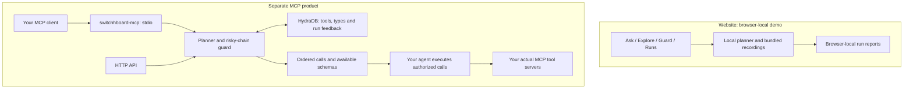
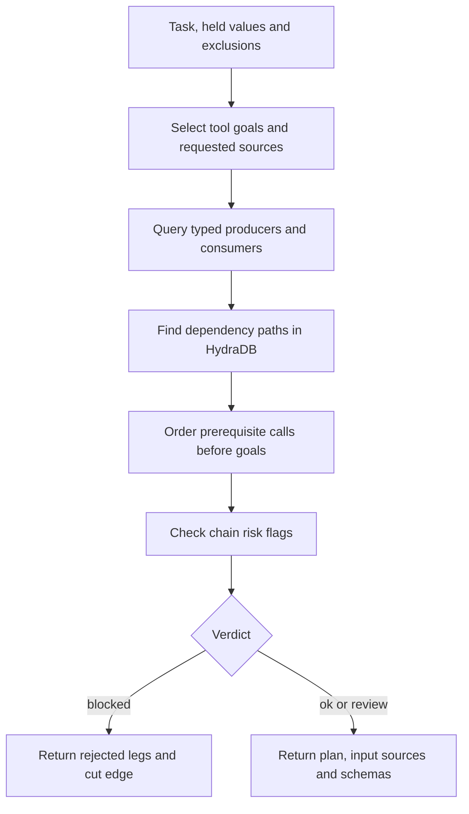
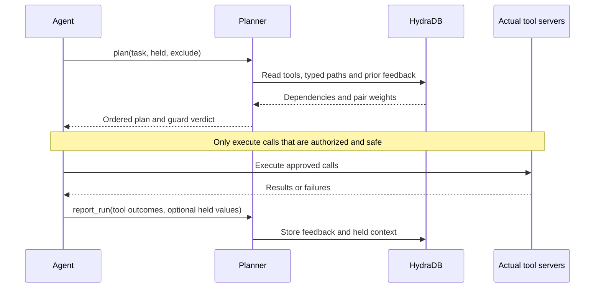

# Switchboardx

**Plan the MCP calls a task needs, in dependency order.**

Switchboard maps tools and their input/output types into a graph. Given a task, held values and optional exclusions, it returns an ordered plan, the available tool schemas and a risky-chain verdict. Your agent and its connected MCP servers execute the calls. Switchboard does not edit code, open pull requests or send email itself.

This repository contains two separate applications:

| Application | What it does | Where its data lives |
| --- | --- | --- |
| Website | Interactive tool-planning, catalog, guard and run-journal demos | Bundled catalog/recordings and browser-local storage. It does **not** call the hosted API. |
| `switchhboard-mcp` | Stdio MCP server, CLI and HTTP API backed by real HydraDB | Your configured HydraDB instance. Explicit embedded mode uses local files instead. |

> The hosted API is an **unauthenticated public demo**, including its run-report endpoint. Use fake or public data only. Account labels are not access control. Do not send private tasks, credentials or personal memory. Free hosting can sleep and reset its data.

## Links and release

- [Website](https://switchboardx.vercel.app/) · [Docs and current demo boundaries](https://switchboardx.vercel.app/docs)
- [npm: `switchhboard-mcp@0.1.0`](https://www.npmjs.com/package/switchhboard-mcp) · [Published version metadata](https://registry.npmjs.org/switchhboard-mcp/0.1.0)
- [Official MCP Registry listing](https://registry.modelcontextprotocol.io/v0.1/servers?search=io.github.ramnnn2006%2Fswitchhboard-mcp): `io.github.ramnnn2006/switchhboard-mcp`
- [Public API health](https://switchhboard-mcp-api.onrender.com/api/health) · [HydraDB health](https://hydradb-graph-node.onrender.com/healthz)
- [Real-server validation run](https://github.com/ramnnn2006/switchboardx/actions/runs/43825937215)

The package name has a **double h**: `switchhboard-mcp`. The repository and website are named `switchboardx`.

Release 0.1.0 uses product runtime code from `7e78ded`. The published package adds the approved `mcpName`, and its registry record uses the current schema, matching registry name and own-HydraDB environment declarations. Those release-only metadata changes are not yet synced into `product/package.json` / `product/server.json`. Do not republish the old registry file unchanged. Some older setup text in `product/README.md` and website install examples still predates publication; the release links and configuration below describe the published product.

## Contents

- [Architecture and planning](#architecture)
- [Quick start and MCP clients](#quick-start-use-your-own-hydradb)
- [Configuration](#configuration-reference)
- [HTTP API](#http-api)
- [Run feedback and the guard](#run-feedback-and-the-guard)
- [Catalogs and ingestion](#catalogs-and-ingestion)
- [Website development](#develop-the-website)
- [Product development and tests](#develop-and-test-the-product)
- [Deployment and workflow warning](#deployment-and-known-limitations)
- [Repository map](#repository-map)
- [Licensing, provenance and security](#licensing-provenance-and-security)

## Architecture



There is intentionally no website-to-API arrow. The public Render API is a separate deployment of the product, not the website's storage service.

### Planning flow



- **Held values** supply typed inputs and can remove prerequisite calls.
- **Exclusions** remove specified tools from consideration and trigger a new plan.
- **HydraDB queries** read the graph and execute `algo.MSpaths`. The `explain` field records the executed path query, measured time, transport and path count.
- **Schemas are partial in the starter catalog.** Tools without stored schemas still have identity and type information. The agent must obtain missing schemas from the actual MCP servers.
- **Execution stays with your agent.** A plausible tool plan is not proof that a natural-language task was completed, or that all business-level steps were captured.

## Quick start: use your own HydraDB

The published package declares Node.js 18 or newer. The hosted API was tested with Node.js 22. You need a running HydraDB server and its bearer token for the default backend.

Start HydraDB using its [upstream documentation](https://github.com/hydra-db/hydradb). This project's real-server CI pins **HydraDB v0.4.0**; see the checked-in workflow for native build dependencies and startup flags, but read the workflow warning below before running it.

In a shell whose environment already contains your own server URL and token:

```bash
# HYDRA_HTTP_URL points to YOUR HydraDB HTTP query service, not the product API.
# HYDRA_TOKEN is your own server's bearer token. Keep it out of source control.
npx -y switchhboard-mcp@0.1.0 stats
npx -y switchhboard-mcp@0.1.0 plan --task "Find open login bugs in Linear"
```

The first connection to an empty graph seeds the bundled catalog. A configured but unreachable database fails startup; it does not silently become an embedded plan.

### MCP client configuration

A generic stdio client configuration:

```json
{
  "mcpServers": {
    "switchboard": {
      "command": "npx",
      "args": ["-y", "switchhboard-mcp@0.1.0"],
      "env": {
        "HYDRA_HTTP_URL": "http://127.0.0.1:8443",
        "HYDRA_TOKEN": "REPLACE_WITH_YOUR_OWN_SERVER_TOKEN"
      }
    }
  }
}
```

The URL is a local-development example; replace it with your own running server. Supply secrets through your client's supported secret mechanism, and never commit a real token. The official registry declares `HYDRA_HTTP_URL` and secret `HYDRA_TOKEN` as installation inputs. It does not embed the public demo's database credential.

The stdio server exposes three tools:

| Tool | Input and result |
| --- | --- |
| `plan` | Task, optional `held`, `exclude`, `allow_destructive`; returns ordered calls and guard verdict. |
| `report_run` | Planned tool IDs with `worked` outcomes, optional task/plan ID and held values; updates run feedback. |
| `catalog_stats` | Tool/type/server counts and bundled preload token cost. |

The no-argument command starts stdio MCP. `SB_API_URL` optionally makes **stdio MCP** forward requests to a product HTTP API. It is not a universal backend flag for the `plan`, `stats` or `serve` CLI commands. If you point it at the public demo, every submitted task/report is public-demo data, not private account storage.

### Explicit offline mode

```bash
npx -y switchhboard-mcp@0.1.0 stats --embedded
npx -y switchhboard-mcp@0.1.0 plan --embedded --task "Find open login bugs in Linear"
```

`--embedded` or `SB_BACKEND=embedded` opts into an in-process graph. It does not contact HydraDB. Its `explain.cypher` is `null`, and its local journal, held values and pair weights use `~/.switchboardx`. This is not evidence of a database execution.

## Configuration reference

| Variable / flag | Scope |
| --- | --- |
| `HYDRA_HTTP_URL` | Your HydraDB HTTP query endpoint. Verified transport in real-server CI. |
| `HYDRA_TOKEN` | Bearer credential for your HydraDB service. Never include it in client-side website code. |
| `HYDRA_BOLT_URL` | Experimental Bolt transport. If both Bolt and HTTP URLs are set, Bolt is selected first. |
| `HYDRA_GRAPH`, `HYDRA_CELL` | Graph and cell identifiers; defaults `default`, `cell-0`. |
| `SB_BACKEND=embedded`, `--embedded` | Explicit no-database mode. |
| `SB_CATALOG`, `--catalog` | Catalog JSON path. |
| `SB_API_URL` | Stdio MCP forwarding target only; use your own protected API for private work. |
| `PORT`, `SB_PORT`, `serve --port` | HTTP listening port; the CLI selects `--port`, then `SB_PORT`, then `PORT`, then 8787. |

## HTTP API

With your own HydraDB environment configured:

```bash
npx -y switchhboard-mcp@0.1.0 serve --port 8787
```

| Method | Path | Purpose |
| --- | --- | --- |
| GET | `/api/health` | Backend and catalog statistics. |
| POST | `/api/plan` | Plan `{ "task": "...", "held": [], "exclude": [] }`. |
| POST | `/api/guard/check` | Plan a task and return its guard verdict. |
| POST | `/api/report_run` | Record tool outcomes and optional held values. |
| POST | `/api/plan_baseline` | Unordered BM25 baseline for comparison: `{ "task": "...", "k": 5 }`. |
| GET | `/api/graph/galaxy` | Catalog nodes and graph edges. |

For example, against your local API:

```bash
curl http://127.0.0.1:8787/api/plan \
  -H 'content-type: application/json' \
  -d '{"task":"Find open login bugs in Linear"}'
```

Responses include `plan_id`, `task`, `capabilities`, `held`, `steps`, `tokens`, `guard` and `explain`. Each step includes tool ID, order, role, typed input sources and an input schema when available. Values can come from already-held context, an earlier step or the agent.

The HTTP server currently has permissive CORS and no end-user authentication. It is not a production multi-tenant service. `account` on HTTP requests is a grouping label, not identity verification; the stdio tool schemas do not expose account selection. Protect a self-hosted API before using private data.

## Run feedback and the guard



Reported successes/failures adjust tool-pair weights used in later planning. This is an explicit feedback loop, not an autonomous model-training service. False reports can corrupt recommendations, particularly on an unauthenticated shared demo.

The guard looks for a chain combining `reads_private`, `ingests_untrusted` and `exfil_sink`, and identifies the risky legs and an edge to cut. Destructive tools require explicit `allow_destructive` permission. Type and risk inference for ingested tools is heuristic: wrong flags or missing task dependencies can produce wrong verdicts. The guard does **not** inspect every payload, enforce authorization on downstream servers or guarantee prompt-injection prevention.

## Catalogs and ingestion

The starter catalog contains **420 tools, 106 types and 20 servers**, with **635 type-to-tool FEEDS edges** in the verified seeded HydraDB graph. It includes stored full input schemas for 51 tools. The catalog describes tools; it does not install or grant access to those third-party services.

Only `product/data/catalog.starter.json` is currently checked in; older product docs mention an official-reference catalog that is not present in this tree. Build a catalog from the MCP servers you actually run rather than assuming a reference description matches your deployment:

```bash
npx -y switchhboard-mcp@0.1.0 ingest \
  --server "npx -y @modelcontextprotocol/server-filesystem /tmp" \
  --name filesystem --catalog ./filesystem.catalog.json
```

`ingest` launches that stdio server, reads `tools/list`, infers types/risk flags and writes or merges a catalog JSON file. Review the generated flags and schemas before use. Run only server commands you trust and give filesystem servers access only to intended directories.

## Develop the website

```bash
git clone https://github.com/ramnnn2006/switchboardx.git
cd switchboardx
npm ci
npm run dev
```

Use Node.js 22 for the website development environment. The Next.js app runs at `http://localhost:3000`. Routes: `/`, `/ask`, `/explore`, `/why`, `/bench`, `/guard`, `/runs`, `/docs`, `/login`, `/signup`. Login/signup are nonfunctional account previews, not authentication.

```bash
npm run build        # Next.js production build
npm run build:pages  # Static export to out/
npm test             # Playwright suite; build out/ first
```

Playwright uses port 3010 and a Python 3 static server. Install its Chromium browser if absent (`npx playwright install chromium`); Linux system dependencies may also be needed. The website requires JavaScript for interactive demos; metadata, page text and Docs answers are server-rendered.

## Develop and test the product

```bash
cd product
npm ci
npm test
```

Without a live database URL, the live integration placeholder is skipped. To run only the real-server suite **against a disposable test graph you control**:

```bash
npm run build
node --test test/hydra.live.it.mjs
```

Set `HYDRA_HTTP_URL` and `HYDRA_TOKEN` first. The suite seeds and mutates the graph, adds synthetic tools and records synthetic runs; do not run it against important data.

### Verification and benchmark boundaries

The [recorded real-server CI run](https://github.com/ramnnn2006/switchboardx/actions/runs/43825937215) passed six HTTP integration tests against HydraDB v0.4.0:

1. Seed a fresh graph and read catalog counts.
2. Execute graph-backed planning with real `algo.MSpaths` diagnostics and dependency ordering.
3. Block the tested private-email/untrusted-content/outbound-email chain.
4. Skip prerequisites for held values.
5. Recover pair weights and held values after recreating the product engine against the same database.
6. Ingest a synthetic tool and use it in a later plan.

The fifth test proves persistence across **engine recreation**, not durable storage on an ephemeral hosting service or a database process restart. Hosted synthetic planning, guard and report smoke checks passed separately. Website tests cover layout, interactions and SEO; they do not establish backend execution.

`product/bench/bench.mjs` and `product/bench/learning.mjs` are small fixture experiments. The bundled full-catalog preload count is 110,238 tokens. Learning uses seven fixture tasks with simulated success/failure feedback. These are mechanism checks, not general agent-accuracy, production-latency or universal token-savings claims. `product/docs/learning-experiment.txt` is an embedded-mode artifact, not the hosted result.

## Deployment and known limitations

- **Website:** Vercel hosts the browser-local demo. No API URL environment variable alone wires it to the product; that needs a deliberate source change and privacy design.
- **HydraDB demo:** Render hosts the real graph-node service with an authenticated database query interface.
- **Product API demo:** Render runs native Node from product source `7e78ded`, using `npm ci --ignore-scripts && npm run build` and `node dist/cli.js serve`. The API itself is unauthenticated, even though its database connection uses a token.
- **Free-host storage:** Services can sleep; files can reset on spin-down/redeploy. Catalog data can reseed, but run-memory durability is not promised. Expect cold starts and temporary health timeouts.
- **Containers:** The HydraDB base and Render-wrapper image builds passed. The product API image build failed; native Node hosting avoids that packaging problem without fixing the Dockerfile. Do not assume the checked-in image blueprints work end to end.
- **Bolt:** Experimental and not the verified HTTP path. Historical handshake/session errors remain a limitation, not a proven alternative.
- **Version drift:** The root README is newer than some product docs, registry metadata and website install text. This README amendment does not silently change any of those files or publish another package version.

### Important workflow warning

**Do not dispatch `.github/workflows/hydra-it.yml` in its current form to validate a documentation or SEO change.** It still begins by extracting a fixed 18-file source payload. That import can overwrite newer files and create an unintended commit, including reverting the SEO updates. The recorded test run above is historical evidence. The importer must be retired or safely separated under an explicit maintenance change before that workflow is reused. The older manual import/image workflows are not an alternative validated release route.

## Repository map

```text
app/                   Next.js routes, metadata, robots and sitemap
components/            Browser demo UI and planner presentation
lib/                   Browser-local planner, graph and interactions
data/                  Website catalog and recorded examples
templates/             Server-rendered reference page markup
public/                Images, fonts, llms.txt and security.txt
product/src/           MCP server, CLI, HTTP API, planner and HydraDB adapter
product/test/          Unit/regression and real-server integration tests
product/bench/         Fixture benchmark and simulated-feedback experiments
product/deploy/        Container definitions and hosting examples
product/data/          Bundled starter tool catalog
```

## Licensing, provenance and security

The product code in `product/` is MIT-licensed: see [product/LICENSE](product/LICENSE) and [product/NOTICE](product/NOTICE). HydraDB is a separate AGPL-3.0 server. The frontend reconstruction preserves the owner's reference design/assets and third-party font, icon and image notices; do not assume the entire repository or every asset is MIT or a clean-room design.

The starter catalog derives from the owner's reference Switchboard tool graph. Tool descriptions and schemas identify third-party MCP servers and retain their authors' rights. Ingestion from your own servers is the recommended basis for a deployment-specific catalog.

For a security report, use the contact in [security.txt](https://switchboardx.vercel.app/.well-known/security.txt). Do not include credentials, personal memory or sensitive payloads in public issues. Website reports stay browser-local; the hosted API has no private-user boundary. Use your own protected deployment for private work.
